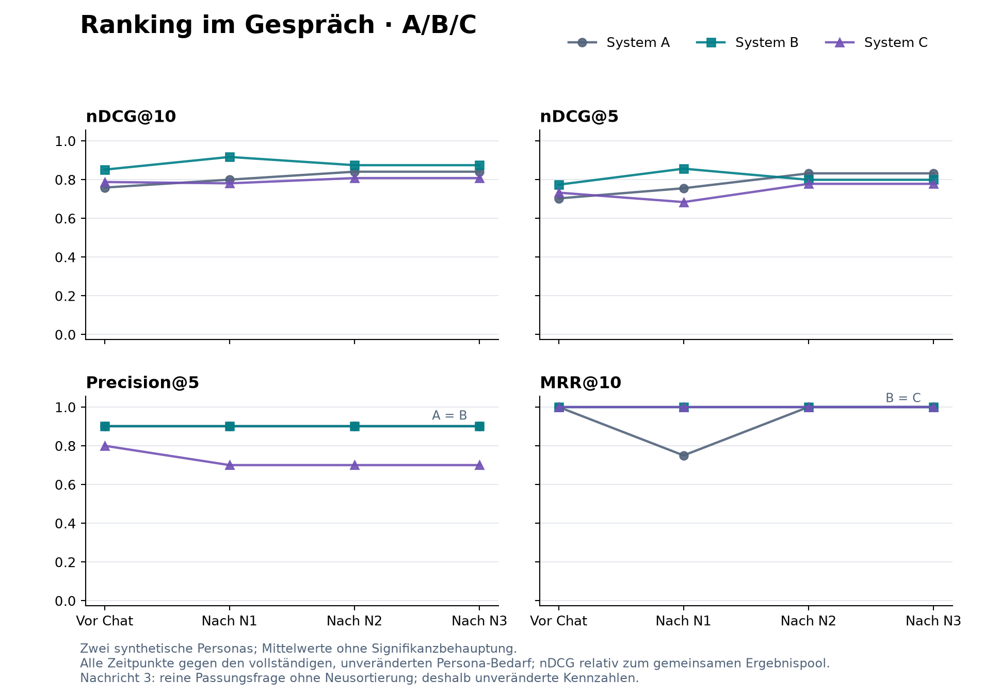

# DIANA: Ergebnisse des Zwei-Personen-Piloten

Alle sechs Sitzungen mit drei Nachrichten sind abgeschlossen. Es liegen 24 Messpunkte vor: zwei fiktive Nutzerinnen × drei Systeme × vier Zeitpunkte. Es wurden 47 Persona-Stellen-Paare anhand der Originalanzeigen bewertet.

**Jeder Messpunkt wird gegen das vollständige, vorab festgelegte Wissen über die jeweilige Persona gemessen.** Die Referenz ändert sich weder zwischen A/B/C noch nach einer Nachricht. Das System erhält die späteren Angaben erst im Gespräch. Ein Job erhält pro Persona genau ein Urteil, das überall wiederverwendet wird.

## Erste Übersicht: 0, 1, 2 und 3

Gleichgewichtete Mittelwerte über Mara und Nora (n=2). 0 = initiale Suche ohne Nutzernachricht, 1–3 = nach der jeweiligen Nachricht. Höhere Werte sind besser. nDCG bezieht sich auf den gemeinsamen Ergebnispool je Persona.

| System | Nachricht | nDCG@10 | nDCG@5 | Precision@5 | MRR@10 |
|---|---:|---:|---:|---:|---:|
| A | 0 | 0.759 | 0.703 | 0.900 | 1.000 |
| A | 1 | 0.800 | 0.755 | 0.900 | 0.750 |
| A | 2 | 0.841 | 0.832 | 0.900 | 1.000 |
| A | 3 | 0.841 | 0.832 | 0.900 | 1.000 |
| B | 0 | 0.851 | 0.774 | 0.900 | 1.000 |
| B | 1 | 0.917 | 0.856 | 0.900 | 1.000 |
| B | 2 | 0.874 | 0.799 | 0.900 | 1.000 |
| B | 3 | 0.874 | 0.799 | 0.900 | 1.000 |
| C | 0 | 0.787 | 0.733 | 0.800 | 1.000 |
| C | 1 | 0.781 | 0.684 | 0.700 | 1.000 |
| C | 2 | 0.808 | 0.778 | 0.700 | 1.000 |
| C | 3 | 0.808 | 0.778 | 0.700 | 1.000 |

**A:** feste Standardberatung. **B:** unveränderte Vorlage Top-Berufsberater. **C:** vorab erstellte eigene Beratung (Mara: Mein Einstiegscoach; Nora: Meine Umstiegsberatung). Dies sind die aktuellen produktiven Varianten, nicht die frühere zufällig sortierte A-Version.

## Was sich daraus ableiten lässt

- B erreicht am Ende den höchsten mittleren nDCG@10 (0,874), A den höchsten nDCG@5 (0,832). Es gibt damit keinen in allen Kennzahlen einheitlichen Sieger.
- A verbessert sich im mittleren nDCG@10 um 0,082 gegenüber dem Start; B um 0,023 und C um 0,020. B begann allerdings schon mit einem höheren Wert. Endniveau und Verbesserung sind unterschiedliche Aussagen.
- Die eigene Konfiguration C zeigt hier keinen allgemeinen Rankingvorteil. Ihre mittlere Precision@5 sinkt von 0,800 auf 0,700; bei A/B bleibt sie bei 0,900.
- Mehr Gesprächsinformation verbessert die Rangfolge nicht automatisch: Bei Mara fällt nDCG@10 nach Nachricht 1 in allen drei Varianten. Bei Nora fällt B nach Nachricht 2 von 0,962 auf 0,872. Solche Rückgänge sind echte Ergebnisse dieses Laufs, keine fehlenden Werte.
- MRR@10 ist fast überall 1,000 und trennt die Varianten deshalb kaum. Eine passende erste Stelle sagt wenig über die Qualität der übrigen Rangliste aus.
- Nachricht 3 ist eine konkrete Rückfrage zur ersten Stelle. Alle sechs Systeme antworten ohne neue Sortierung. Ihre Metriken sind daher exakt gleich wie nach Nachricht 2; das ist eine erwartete Messung, kein ausgelassener Test.

## Konkreter technischer Befund

Bei Mara widersprechen mehrere zunächst hoch empfohlene Betreuungsangebote dem expliziten Mindestsemester. Beispielsweise steht nach Nachricht 1 in A Job 820065 an erster Stelle, obwohl die Originalanzeige das vierte Semester oder höher fordert und Mara im zweiten Semester ist. Das feste Urteil lautet daher 0; der erste relevante Treffer liegt dann auf Rang 2 (RR@10 = 0,5). Betreuungswünsche dürfen eine belegte formale Zugangshürde nicht überdecken.

Die ersten beiden Nachrichten führten in sämtlichen Varianten zu einer Neubewertung der bestehenden 20 Stellen. Es gab nach T0 keine neue Korpussuche und keine Aufnahme neuer Stellen. Der Verlauf zeigt deshalb Veränderungen innerhalb der ursprünglichen Kandidatenmenge. Eine neue Suche nach stark veränderten Wünschen wurde durch diese Gespräche nicht ausgelöst.

## Umfang, Laufzeit und Kosten

- Originalbestand: 8.537 Stellen. Die Retrievalsuche arbeitet auf dem nach Stellenart gefilterten Originalbestand; die KI bewertet danach die 20 vorausgewählten Stellen.
- Sechs Sitzungen, 18 Nutzernachrichten, 24 vollständige Snapshots, 42 erfolgreiche Modellaufrufe.
- Produktionsmodell unverändert: `gpt-5.4-2026-03-05`, Denkaufwand `none`. Höchstens zwei parallele Sitzungen; keine externen Simulator- oder Bewertungsmodelle.
- Initiale Suche durchschnittlich 51,0 Sekunden; erste Neubewertung 35,9 Sekunden, zweite 37,6 Sekunden; reine Antwort 6,7 Sekunden. Das sind lokale Backend-Laufzeiten im Test, keine Messung der Browserdarstellung oder Streaming-Latenz.
- Tokenkosten konservativ nach Standardpreisen: **3,6641125 USD**. Cache-Rabatte, Freikontingente und Steuern sind nicht berücksichtigt; dies ist keine Abrechnung.
- Ursprüngliches Limit 3 USD; nach T1 vom Nutzer ausdrücklich auf 4,50 USD insgesamt erhöht. Die ursprünglichen Dateien und die Änderung sind unter `run/amendments/01-budget-authorization/` erhalten. Es wurden keine kostenpflichtigen Fehlerwiederholungen durchgeführt.
- Echte Umfrageantworten und Zuordnungen wurden nicht verändert; die Sitzungen verwendeten isolierte temporäre Datenbanken.

## Einordnung für die Forschung

Dies ist ein deskriptiver technischer Pilot mit zwei konstruierten Personen und einer Durchführung pro Person/Variante. Die 24 Zeitpunkte sind keine 24 unabhängigen Nutzer. Er liefert konkrete Fehlerbeispiele und plausible Hypothesen, aber keinen belastbaren allgemeinen Überlegenheits- oder Kausalnachweis für Personalisierung. Stochastische Modellunterschiede und zusätzliche Gesprächsinformation können die Unterschiede ebenfalls erklären.

Die Urteile wurden durch Codex anhand des vollständigen Bedarfs und der Originalanzeigen erstellt, ohne Rankings, Systemscore oder Systembegründungen im jeweiligen Bewertungspaket. Es gibt keine menschlich validierte Referenz und keine zweite unabhängige Beurteilung jedes Jobs. Die ideale nDCG-Rangliste stammt aus den 23 beziehungsweise 24 gepoolten Treffern, nicht aus einer Vollbewertung aller 8.537 Anzeigen. Ähnliche Ausschreibungen mit eigenen IDs wurden nicht nachträglich dedupliziert. Historische Anzeigen wurden nicht auf aktuelle Verfügbarkeit geprüft.

Rankingmetriken bewerten weder die Gesprächsqualität noch die Zufriedenheit oder die tatsächlichen Einstellungschancen. Der volle Zielbedarf kann außerdem Wünsche enthalten, die in den drei vorgesehenen Nachrichten noch nicht vollständig offengelegt wurden; er bleibt trotzdem für alle Messpunkte gleich.

## Dateien und erneute Berechnung

- [Alle Einzelwerte, Differenzen und Fallzahlen](run/analysis/report.md)
- [Maschinenlesbare Auswertung](run/analysis/report.json)
- [Grafik als SVG](run/analysis/ranking-verlauf.svg)
- [Persona Mara](documents/P01-mara-seidel.docx) · [Persona Nora](documents/P06-nora-peters.docx)
- [Bewertungen Mara](run/judgments/P01.json) · [Bewertungen Nora](run/judgments/P06.json)
- [Eingefrorenes Protokoll](PROTOCOL.md) · [Ausführungsnachweis](run/execution-summary.json)
- Tatsächliche Gespräche: [Mara A](run/cases/P01-A/transcript.md), [Mara B](run/cases/P01-B/transcript.md), [Mara C](run/cases/P01-C/transcript.md), [Nora A](run/cases/P06-A/transcript.md), [Nora B](run/cases/P06-B/transcript.md), [Nora C](run/cases/P06-C/transcript.md).

Die Tabellen lassen sich ohne weitere API-Kosten mit `summarize.py --run research/persona-study-2026-09-17/run` neu berechnen; anschließend erzeugt `create_figures.py` die Grafiken. Die alten Tests wurden zuvor auf Nutzerwunsch außerhalb des Projekts archiviert; [Entfernungsnachweis](old-tests-removed.json).
